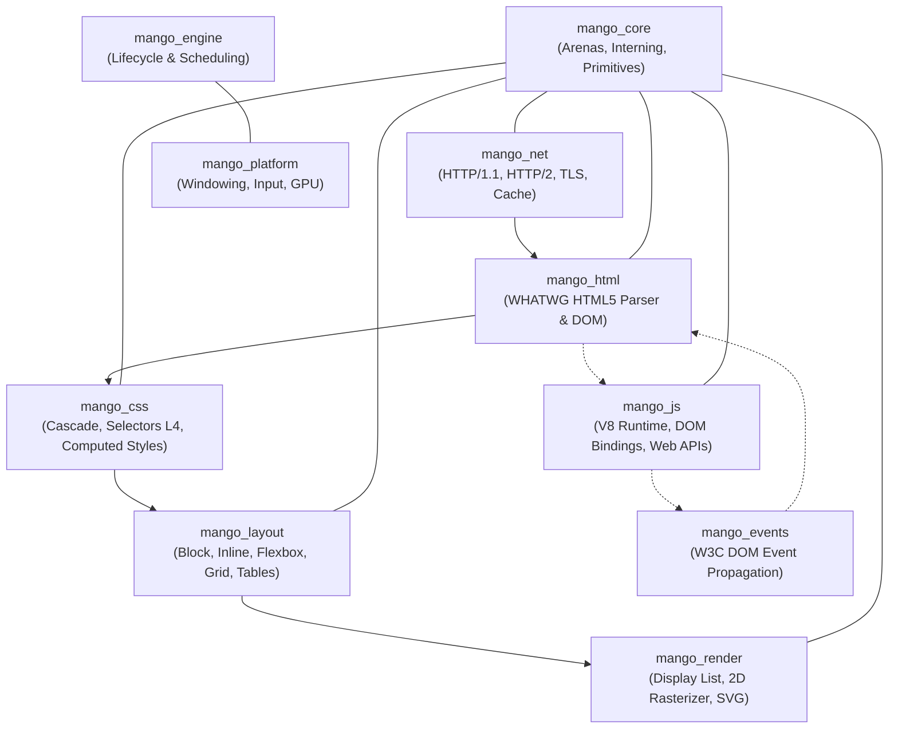
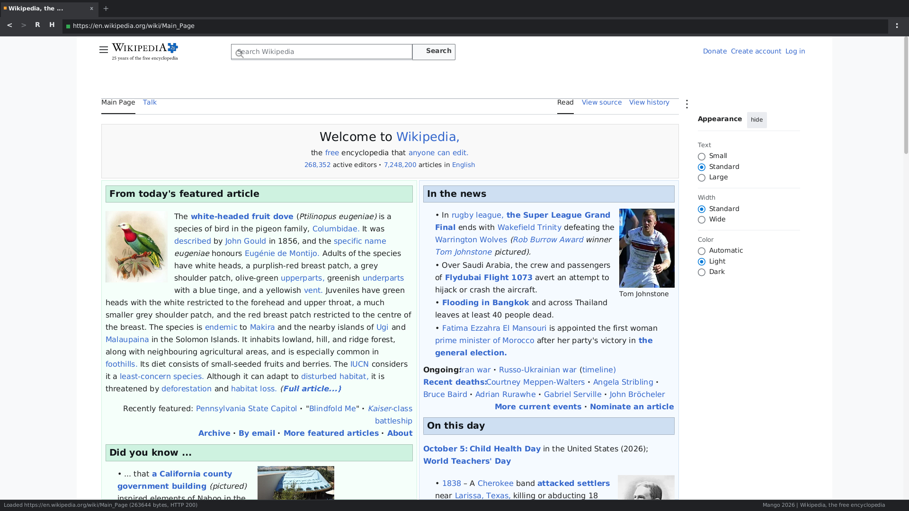
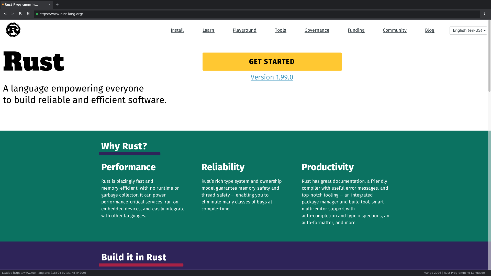
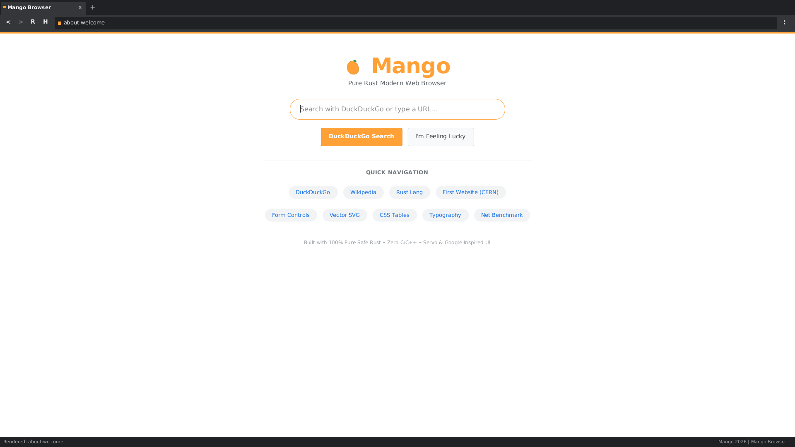

<div align="center">

# 🥭 Mango Browser

**An experimental, lightweight web browser and rendering engine written from scratch in pure Rust.**

[](Cargo.toml)
[](https://github.com/kuntal-devrat/mango/actions/workflows/ci.yml)
[](#-web-platform-tests-wpt-conformance)
[](#-web-platform-tests-wpt-conformance)
[](Cargo.toml)
[](LICENSE)
[](https://www.rust-lang.org/)

<p align="center">
  <a href="#overview">Overview</a> •
  <a href="#key-features--capabilities">Key Features</a> •
  <a href="#human--ai-collaboration">Human + AI</a> •
  <a href="#architecture">Architecture</a> •
  <a href="#-web-platform-tests-wpt-conformance">WPT Conformance</a> •
  <a href="#screenshots">Screenshots</a> •
  <a href="#quickstart">Quickstart</a> •
  <a href="#contributing">Contributing</a>
</p>

</div>

---

## Overview

Modern web browsers have grown into multi-gigabyte operating systems that consume substantial memory just to display text and articles. **Mango** is an experimental open-source browser and engine exploring a focused premise:

> **The Web is fundamentally a document platform.**

Mango is built from the ground up in memory-safe Rust with modular, zero-C++ engine dependencies. It implements custom HTML5 parsing, CSS cascade and styling, multi-formatting-context layout (block, inline, flexbox, grid, and tables), a 2D software rasterizer with GPU compositor fallback, and an embedded JavaScript runtime for standard DOM interactions.

> **Status:** Mango is under active, iterative development. While it already renders complex real-world pages (Wikipedia, Rust-lang, GitHub, DuckDuckGo), it is an experimental project, not yet a replacement for production general-purpose browsers.

---

## ✨ Key Features & Capabilities

* **Canonical Pure-Rust Complex Script Shaping**:
  * Unified script shaping engine in `mango_render` with zero native C/C++ dependencies:
    * **Arabic**: Full contextual character joining (isolated, initial, medial, final forms), mandatory Lam-Alef ligatures (`\u{FEFB}`..=`\u{FEFE}`), and Tashkeel/harakat transparency across diacritics.
    * **Devanagari**: Conjunct clustering, Halant/Virama ligature handling, Nukta composition into pre-composed Unicode glyphs, and pre-base short-I matra (`\u{093F}`) reordering before consonant base clusters.
    * **Thai**: Combining diacritic canonical normalization (inverting misplaced above-vowels and tone marks), vertical mark stacking, and syllable boundary segmentation.
    * **Emoji Sequences & Variation Selectors**: Zero-advance format codes (`\u{200B}`..=`\u{200D}`) and variation selectors (`\u{FE00}`..=`\u{FE0F}`) correctly shaped without phantom emoji bounding boxes.
* **Asynchronous `@font-face` Live Reflow**:
  * Background web font fetch/decode pipeline that invalidates layout and display lists via `web_font_epoch()`, guaranteeing zero permanent blank text or FOUT when web fonts complete loading.
* **Multi-Formatting-Context CSS Engine**:
  * **Flexbox**: Multi-line wrapping (`wrap-reverse`, `align-content: stretch`), min-width auto intrinsic sizing, cross-axis distribution (**84.39% pass rate** on 570 WPT tests).
  * **Positioning & Stacking**: Sticky positioning with scroll containment (**100% pass rate**), relative table parts, CSS 2.1 Appendix E paint-order and negative z-index hit-testing, clip-path, border-radius corner clipping, and CSS `clip: rect(...)` (**98.76% pass rate** on 161 WPT tests).
  * **Cascade & Variables**: Full ancestor propagation with >256 custom properties, `:is()` and `:where()` specificity resolution (**100% pass rate** on 42 `css-cascade` tests).
* **Responsive Architecture & Non-Blocking UI**:
  * Decoupled UI thread (windowing, smooth scrolling, omnibox, tab switching) with $<10$ms frame dispatch while long-running JavaScript or layout executes on dedicated worker threads.
* **Memory-Bounded LRU Caches**:
  * Configurable active byte budgets: 64MB for decoded full-frame images, 32MB for resized variants, and 16MB for rasterized glyph bitmaps.
* **Interactive Form Controls & Native Widgets**:
  * Text inputs, password fields, checkboxes, radio buttons with document vs. form group scoping, range sliders, number steppers, color swatches, native date/time civil calendar popups, and custom dropdown menus.

---

## 🤖 Human + AI Collaboration

Mango is developed transparently through **human and AI pair-programming**. We use advanced AI coding assistants (including Claude, Cursor, and custom agentic tools) working alongside human engineers to plan architectures, implement standards, write regression tests, and fix bugs.

We believe that open, verified human-AI collaboration enables small teams and solo developers to build ambitious systems software. 

* **All contributions are welcome** — whether written by hand or with AI assistance.
* **You own the code you submit**: Every contribution (AI-assisted or manual) must be thoroughly understood, verified, accompanied by tests, and pass all CI checks.
* **No unverified AI output**: We reject raw, untested AI-generated spam or hallucinations.

Read our [Contributing Guide](CONTRIBUTING.md) for details on our workflow and quality standards.

---

## Architecture

Mango is organized as a Cargo workspace with decoupled, modular crates:



### Workspace Crates

| Crate | Role |
|---|---|
| [`mango_core`](crates/mango_core) | Arenas, string interning, colors, geometry primitives. |
| [`mango_html`](crates/mango_html) | WHATWG HTML5 tokenization, tree building, entity decoding, DOM nodes. |
| [`mango_css`](crates/mango_css) | CSS3 tokenizer, parser, selectors (Level 4), specificity, computed styles. |
| [`mango_layout`](crates/mango_layout) | Box trees, block/inline formatting, flexbox, CSS grid, table layout. |
| [`mango_render`](crates/mango_render) | Display lists, 2D rasterizer, font shaping, SVG rasterization, compositor. |
| [`mango_net`](crates/mango_net) | HTTP/1.1 & HTTP/2, TLS, DNS resolver, cookie jar, security (CSP/CORS). |
| [`mango_js`](crates/mango_js) | JavaScript engine integration, DOM prototypes, Web APIs, event loop. |
| [`mango_events`](crates/mango_events) | W3C DOM event propagation (capture, target, bubble phases). |
| [`mango_engine`](crates/mango_engine) | Document lifecycle, restyle, and relayout scheduling. |
| [`mango_ipc`](crates/mango_ipc) | Multi-process IPC protocol, serialization, and renderer actor communication channels. |
| [`mango_platform`](crates/mango_platform) | Windowing, input events, GPU compositor via Vulkan/Metal/DX12. |

---

## 🏆 Web Platform Tests (WPT) Conformance

Mango is continuously verified against upstream W3C and WHATWG specifications using **canonical upstream Web Platform Tests** (`web-platform-tests/wpt`). No synthetic mocks, proxies, or simulated scorecards are used.

| Category / Suite | Assertions / Tests Passed | Pass Rate | Scope |
|---|:---:|:---:|---|
| **WHATWG DOM Core** (`upstream/dom/nodes/`) | **1,581 / 1,581** | **100.0%** | 23 core suites (Document, Element, Node, DOMImplementation) |
| **WHATWG DOM CharacterData** | **157 / 157** | **100.0%** | Hard regression gate on § 4.4 text and comments |
| **Official WPT DOM Category** (`upstream/dom/`) | **8,037 / 10,294** | **78.07%** | 399 test files across DOM nodes, mutation, events, collections |
| **Upstream W3C CSS Visual Reftests** (`tests/wpt_css_reftests_runner.rs`) | **708 / 799** | **88.61%** | 799 reftests: cascade (100%), sticky (100%), margin-trim (100%), position (98.8%), flexbox (84.4%) |
| **Official WPT CSS Category** (`upstream/css/`) | **1,105 / 2,186** | **50.55%** | 663 test files across cascade, flexbox, grid, tables, box model |
| **Workspace Unit Tests** (`cargo test --workspace --lib`) | **873 / 873** | **100.0%** | Comprehensive unit test suite across all 11 workspace crates |

Run the upstream W3C CSS visual reftests locally:
```bash
cargo test --test wpt_css_reftests_runner -- --nocapture
```

Run the full official test suite locally:
```bash
cargo test --test wpt_official_runner -- --nocapture
```

---

## Screenshots

<div align="center">

### Wikipedia (`https://en.wikipedia.org/wiki/Main_Page`)


### Rust Language Homepage (`https://www.rust-lang.org/`)


### Native Browser Chrome & Welcome Page


</div>

---

## Quickstart

### Prerequisites

* **Rust**: Stable toolchain (1.75+). Install via [rustup.rs](https://rustup.rs/):
  ```bash
  rustup update stable
  ```
* **Linux Dependencies** (for desktop windowing):
  ```bash
  sudo apt-get install -y pkg-config libx11-dev libasound2-dev libfontconfig1-dev
  ```

### Running the Desktop Browser

```bash
cargo run --release --bin mango
```

### Running the Headless Viewport Renderer

Mango includes a headless renderer for automated screenshotting, visual diffing, and diagnosing layout geometry:

```bash
# Render a webpage to PNG at 1280x900 viewport
cargo run --release --bin headless -- "https://www.rust-lang.org" rust.png 1280 900 --page

# Probe element geometry and computed styles by CSS selector
cargo run --bin headless -- "https://github.com" --probe ".header-logo" 1280 900
```

### Running Tests

```bash
# Run all workspace unit, integration, and spec parity tests
cargo test --workspace

# Run official Web Platform Tests (WPT) suites
cargo test --test wpt_official_runner
```

---

## Contributing

We welcome issues and pull requests! Please review our [Contributing Guidelines](CONTRIBUTING.md) before getting started.

* **Starter Issues**: Check out our curated list of [Starter Issues on GitHub](https://github.com/kuntal-devrat/mango/issues) tagged `good first issue` ready to be tackled!
* **Keep PRs small and modular**: We prioritize small, focused pull requests (single bug fix or feature) that are easy to review and maintain.
* **Quality bar**: All PRs must pass `cargo test --workspace`, have zero compiler/clippy warnings, and maintain clean modular source files ($\le 800$ lines per file).

---

## License

Mango Browser is open-source software licensed under the [MIT License](LICENSE).
