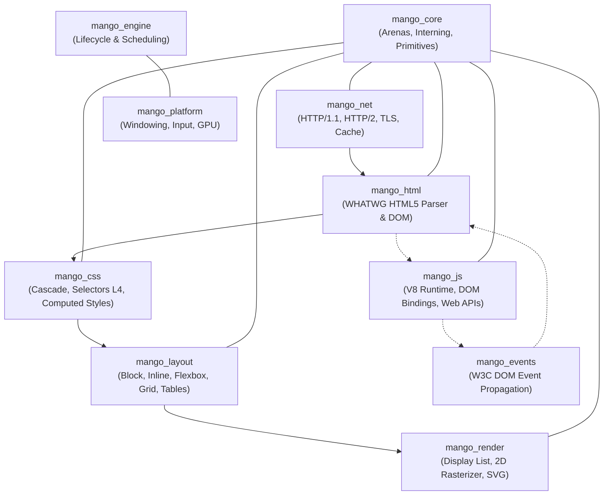

<div align="center">

# 🥭 Mango Browser

**An experimental, lightweight web browser and rendering engine written from scratch in pure Rust.**

[](Cargo.toml)
[](https://github.com/kuntal-devrat/mango/actions/workflows/ci.yml)
[](LICENSE)
[](https://www.rust-lang.org/)
[]()

<p align="center">
  <a href="#overview">Overview</a> •
  <a href="#human--ai-collaboration">Human + AI</a> •
  <a href="#architecture">Architecture</a> •
  <a href="#screenshots">Screenshots</a> •
  <a href="#quickstart">Quickstart</a> •
  <a href="#contributing">Contributing</a>
</p>

</div>

---

## Overview

Modern web browsers have grown into multi-gigabyte operating systems that consume substantial memory just to display text and articles. **Mango** is an experimental open-source browser and engine exploring a focused premise:

> **The Web is fundamentally a document platform.**

Mango is built from the ground up in memory-safe Rust with modular, zero-C++ engine dependencies. It implements custom HTML5 parsing, CSS cascade and styling, multi-formatting-context layout (block, inline, flexbox, grid, and tables), a 2D software rasterizer with GPU compositor fallback, and an embedded JavaScript runtime for standard DOM interactions.

> **Status:** Mango is under active, iterative development. While it already renders complex real-world pages (Wikipedia, Rust-lang, GitHub, DuckDuckGo), it is an experimental project, not yet a replacement for production general-purpose browsers.

---

## 🤖 Human + AI Collaboration

Mango is developed transparently through **human and AI pair-programming**. We use advanced AI coding assistants (including Claude, Cursor, and custom agentic tools) working alongside human engineers to plan architectures, implement standards, write regression tests, and fix bugs.

We believe that open, verified human-AI collaboration enables small teams and solo developers to build ambitious systems software. 

* **All contributions are welcome** — whether written by hand or with AI assistance.
* **You own the code you submit**: Every contribution (AI-assisted or manual) must be thoroughly understood, verified, accompanied by tests, and pass all CI checks.
* **No unverified AI output**: We reject raw, untested AI-generated spam or hallucinations.

Read our [Contributing Guide](CONTRIBUTING.md) for details on our workflow and quality standards.

---

## Architecture

Mango is organized as a Cargo workspace with decoupled, modular crates:



### Workspace Crates

| Crate | Role |
|---|---|
| [`mango_core`](crates/mango_core) | Arenas, string interning, colors, geometry primitives. |
| [`mango_html`](crates/mango_html) | WHATWG HTML5 tokenization, tree building, entity decoding, DOM nodes. |
| [`mango_css`](crates/mango_css) | CSS3 tokenizer, parser, selectors (Level 4), specificity, computed styles. |
| [`mango_layout`](crates/mango_layout) | Box trees, block/inline formatting, flexbox, CSS grid, table layout. |
| [`mango_render`](crates/mango_render) | Display lists, 2D rasterizer, font shaping, SVG rasterization, compositor. |
| [`mango_net`](crates/mango_net) | HTTP/1.1 & HTTP/2, TLS, DNS resolver, cookie jar, security (CSP/CORS). |
| [`mango_js`](crates/mango_js) | JavaScript engine integration, DOM prototypes, Web APIs, event loop. |
| [`mango_events`](crates/mango_events) | W3C DOM event propagation (capture, target, bubble phases). |
| [`mango_engine`](crates/mango_engine) | Document lifecycle, restyle, and relayout scheduling. |
| [`mango_platform`](crates/mango_platform) | Windowing, input events, GPU compositor via Vulkan/Metal/DX12. |

---

## Screenshots

<div align="center">

### Wikipedia (`https://en.wikipedia.org/wiki/Main_Page`)


### Rust Language Homepage (`https://www.rust-lang.org/`)


### Native Browser Chrome & Welcome Page


</div>

---

## Quickstart

### Prerequisites

* **Rust**: Stable toolchain (1.75+). Install via [rustup.rs](https://rustup.rs/):
  ```bash
  rustup update stable
  ```
* **Linux Dependencies** (for desktop windowing):
  ```bash
  sudo apt-get install -y pkg-config libx11-dev libasound2-dev libfontconfig1-dev
  ```

### Running the Desktop Browser

```bash
cargo run --release --bin mango
```

### Running the Headless Viewport Renderer

Mango includes a headless renderer for automated screenshotting, visual diffing, and diagnosing layout geometry:

```bash
# Render a webpage to PNG at 1280x900 viewport
cargo run --release --bin headless -- "https://www.rust-lang.org" rust.png 1280 900 --page

# Probe element geometry and computed styles by CSS selector
cargo run --bin headless -- "https://github.com" --probe ".header-logo" 1280 900
```

### Running Tests

```bash
# Run all workspace unit, integration, and spec parity tests
cargo test --workspace

# Run official Web Platform Tests (WPT) suites
cargo test --test wpt_official_runner
```

---

## Contributing

We welcome issues and pull requests! Please review our [Contributing Guidelines](CONTRIBUTING.md) before getting started.

* **Starter Issues**: Check out our curated list of [Starter Issues on GitHub](https://github.com/kuntal-devrat/mango/issues) tagged `good first issue` ready to be tackled!
* **Keep PRs small and modular**: We prioritize small, focused pull requests (single bug fix or feature) that are easy to review and maintain.
* **Quality bar**: All PRs must pass `cargo test --workspace`, have zero compiler/clippy warnings, and maintain clean modular source files ($\le 800$ lines per file).

---

## License

Mango Browser is open-source software licensed under the [MIT License](LICENSE).
